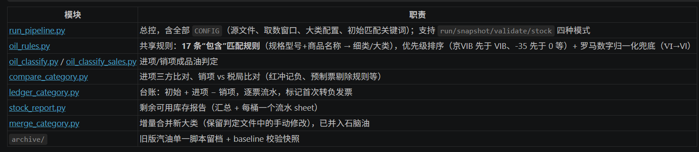

# 程序使用说明
## 1. TMP大类库存 - 税局大类库存 是否等于 初始值差异 
### 程序:stock_recon.py
### 程序目的
比对初始库存差异（TMP初始值 - 税局初始值）是否等于库存累加后差异（TMP库存 - 税局库存）
如果一样就说明TMP库存没问题, **就不用再做后续的比较了**

Energy初始数据.xlsx 是2026-07-16用户给的初始库存，TMP初始库存天然就比税局初始值小
- TMP初始值 ：Energy初始数据.xlsx G列
- 税局初始值：Energy初始数据.xlsx H列

按道理（取数口径都是7/16~10/23）：
- A = G列 + TMP进项 - TMP销项 - gain&loss（税局没有这部分数据要减掉），
- B = H列 + 税局进项 - 税局的销项（7/16~10/23）

**正常情况下，A - B 应该等于 Energy初始数据【G】 - 【H】，这就代表TMP的成品油变动和数据一致**

程序输入：
- 税局发票文件 (回车=税局Energy增值税发票7.1-10.23.xlsx): 数据下载的Energy进项销项发票（从2026/7/16 - 比对时间点，如10/23）
- TMP库存快照文件 (回车=TMP成品油库存.xlsx): TMP当前的销项成品油库存，如：10/23, 它的库存就是以7/16的初始值开始算的
- GainLoss明细文件 (回车=TMPGainLoss明细.xlsx): TMP当前的gain/loss明细，如：10/23
- 初始数据文件 (回车=Energy初始数据.xlsx): 就是"Energy初始数据.xlsx"
- 取数起始日 (yyyy-mm-dd) (回车=2026-07-16):不变
- 取数截止日 (yyyy-mm-dd) (回车=2026-10-23):当前比对时间
- 取数窗口: 2026-07-16 ~ 2026-10-23 (含当天)

程序输出：C:\D\AIWork\pwc-project\trafigura-tmp\energy\output\库存比对\库存差异核对_XXXX


## 2. 计算正确的库存
### 程序：run_pipeline.py
### 程序目的1. 在TMP导出的成品油进项、销项文件基础上，添加每个发票的大类、细类标识
    - output：成品油发票判定_Energy进项20260501-20261026.xlsx
    - output: 成品油发票判定_Energy销项.xlsx
2. 验证“TMP进项发票”和“税局Energy进项发票” 是否match：用TMP进项发票、TMP进项购进明细、税局Energy进项发票做3方比对
    - output:汽油数量比对_进项_三方.xlsx
3. 验证“TMP销项发票”和“税局Energy销项发票m” 是否match：用TMP销项发票、税局Energy销项发票做比对
    - output:汽油数量比对_销项vs税局.xlsx
    - <span style="color:red;">第2、3的目的是确保TMP进项、销项发票和税局的保持一致。如果一致，就说明从票面维度，双方的变动一致。TMP库存如果有问题，就不是缺少发票，而是库存计算逻辑本身</span>
4. 用TMP期初 + TMP进项发票+销项发票（先不考虑gain/loss），算出**TMP实际大类**库存（A）；用税局期初 + TMP进项发票+销项发票，算出**税局实际大类**库存(B)。（A - B） 应该等于（TMP期初 - 税局期初）:todo report还未体现
    - output:汽油数量结果_初始加进项减销项.xlsx
5. 用TMP期初 + TMP进项发票+销项发票（先不考虑gain/loss） 算出**细类**库存。带每个细类的计算流水
    - output: 库存计算_细类_汽油.xlsx

**run_pipeline.py 的全部输出文件（上面1~5）统一写入 `energy/output/库存计算/`，文件名都带时间戳后缀 `_yyyymmddhhmmss`（同一次 run 共享同一时间戳），不会覆盖历史结果。**


## 3. 流水和TMP日志比对
### 程序：ledger_vs_tmplog.py
### 程序目的
对比“第2步生成的细类计算流水”和“TMP细类的日志” ，能具体知道到底是哪个发票计算库存时出错了


# 成品油发票数量比对流程 - 使用说明




## 流程总览

```
原始进项发票 ─┐                                          ┌─ {大类}数量比对_进项_三方.xlsx ─┐
              ├─ 步骤1 成品油判定 ─┬─ 进项判定文件 ──────┤                                ├─ 步骤3 台账 ─→ {大类}数量结果_初始加进项减销项.xlsx
原始销项发票 ─┘                    └─ 销项判定文件 ──────┴─ {大类}数量比对_销项vs税局.xlsx ──┘
税局成品油发票 / TMP购进数据 / Energy初始数据 (步骤2、3 的输入)
```

| 步骤 | 模块 | 输出 |
|---|---|---|
| 1a 进项判定 | oil_classify.py | 成品油发票判定_进项.xlsx |
| 1b 销项判定 | oil_classify_sales.py | 成品油发票判定_销项.xlsx |
| 2a 进项三方比对 | compare_category.run_input | {大类}数量比对_进项_三方.xlsx |
| 2b 销项比对 | compare_category.run_output | {大类}数量比对_销项vs税局.xlsx |
| 3 台账 | ledger_category.run | 库存计算/{大类}数量结果_初始加进项减销项.xlsx |
| 库存 | stock_report.run | 库存计算/库存计算_细类_{大类}.xlsx |

共享规则: oil_rules.py (15条包含匹配规则 + 归一化 + 输出样式)

## 日常使用 (换数据跑全流程)

1. 替换 `energy/` 下的原始进项、销项发票文件
2. 打开 `run_pipeline.py`, 改 `CONFIG` 里对应的文件名与取数窗口(进项源文件窗口/税局取数起始日/截止日)
3. 在 `energy/output` 下运行:
   ```
   python -I run_pipeline.py
   ```
   一次性生成 5 类输出文件, 控制台(stderr)打印输入文件清单/取数窗口及各步骤统计。

**输出文件名带时间戳**: 所有输出文件名末尾追加 `_yyyymmddhhmmss` (本次 run 的启动时刻,
同一次 run 的全部输出共享同一时间戳; 库存报告同理), 重复运行不会覆盖历史结果。
`snapshot`/`validate`/`stock --no-run` 会自动引用最新一次 run 的输出; 无时间戳文件时
沿用旧命名。基准快照在 `archive/baseline/` 中去掉时间戳存放, 校验不受影响。

4. 注意点
- 数量比对_进项_三方 时是剔除了92号车用乙醇汽油调合组分油（VIB）、95号车用乙醇汽油调合组分油（VIB）。因为在“TMP购进数据”文件中它被归到了**汽油大类**，但在“税局成品油发票”文件中，我们又是用【商品名称】作为大类的，它们被划分到“车用乙醇汽油调和组分油”下面了。
如果在TMP购进中包含进去的话就会造成和税局数字比对不上 —— 大类名称不符合。
todo:加一个逻辑，把税局文件的“车用乙醇汽油调和组分油”也作为“汽油”


## 剩余可用库存计算 (stock 模式)

报告输出到 `energy/output/库存计算/`。

```
python -I run_pipeline.py stock                # 缺参数时交互式询问
python -I run_pipeline.py stock --level 细类 --cats 汽油 \
    --subs 92号车用汽油（VIB）,95号车用汽油（VIB）,98号车用汽油（VIB）,95号车用汽油（京VIB）,92号车用汽油（京VIB）
python -I run_pipeline.py stock --level 大类 --cats 石脑油 --no-run   # --no-run 用已有输出, 不重跑流程
```

参数:
- `--level` 大类 / 细类 (默认细类)
- `--cats` 大类名称, 逗号分隔可多个 (默认汽油)
- `--subs` 细类名称, 逗号分隔可多个 (level=细类时必填)
- `--no-run` 不重跑流程, 直接用已有输出文件计算

输出: 细类级 -> `库存计算_细类_{大类}.xlsx`; 大类级 -> `库存计算_大类_{大类}.xlsx` (同一套报告引擎: 汇总 + 每桶一个流水 sheet)

口径:
- **细类级**: 进项取判定文件明细数量; 销项取已开票明细数量 (红冲为负, **已预制票剔除**, 与大类台账税局口径一致, 剔除清单在汇总列明); 取数窗口自初始日期起(之前发生额已含在初始库存); 初始数据取 Energy初始数据.xlsx **G列**, 按 `CONFIG['细类初始匹配']` 关键词匹配行 (如 `92#小计`), 取不到或 G 列为空记 **0**, 报告注明来源; 未识别细类(NA)的发票在汇总逐票列出并给出窗口内合计, 便于与大类台账对账
- **大类级**: 同一套明细口径, 但每个大类一个桶 (该大类下所有细类行、含 NA 细类行都计入); 初始数据按 `CONFIG['大类初始匹配']` 关键词匹配 G 列 (如 石脑油 -> `石脑油合计`), 取不到记 0 并注明来源
- **未识别细类的发票不剔除**: 细类级下, 大类命中但细类=NA 的发票在汇总中逐票列出提示 (`!!` 红字段), 未识别明细单列 `未识别细类明细` sheet; 其他未纳入本次计算的细类也一并列出, 数量未计入任何细类 (大类级无此问题, 全部计入)
- 每个桶一个流水 sheet: 日期/方向/发票号码/销方/购方/大类/细类/数量变动/累计结余, 负数结余标红, 标记首次转负发票; 被剔除的已预制票附在流水表尾 (如有)

## 校验 (确认新代码/新环境输出与历史一致)

```
python -I run_pipeline.py snapshot   # 把当前输出快照到 archive/baseline 作为基准
python -I run_pipeline.py            # 改代码或重跑
python -I run_pipeline.py validate   # 逐单元格(数字容差1e-9)对比基准, 报告写 _validate_report.txt
```

当前基线: 2026-10-27 建立, 5 个输出文件全部一致。

## 新增大类 (如柴油)

1. `CONFIG['比对大类']` 加入 `'柴油'`
2. `CONFIG['大类配置']['柴油']` 补三项:
   - `税局商品名称`: 税局文件"商品和服务名称"的取值
   - `TMP油品类型`: TMP购进数据"油品类型"编码 (1=汽油, 2=柴油, 3=其他)
   - `TMP剔除细类`: 需剔除的"油品细类"元组 (无则留空元组 `()`)
3. 初始数据需有 `柴油合计` 行 (Energy初始数据.xlsx), 否则步骤3报错
4. 直接 `python -I run_pipeline.py` 即可, 柴油的 3 个输出文件自动生成

### 不重跑全量, 只把新大类合并进现有判定文件 (保留手动修改)

全量重跑 `oil_classify*.run` 会覆盖判定文件里的手动修改 (如 NA 票改细类)。
此时用 `merge_category.py` 做**增量合并**: 只把原始进/销项中按规则命中该大类、
而现有判定文件未识别 (是否成品油=否) 的明细行就地更新, 缺的行追加, 发票汇总同构补齐;
其余现有行 (含手动修改) 一律不动、不重排, 新行追加在表尾:

```python
import merge_category
merge_category.run('石脑油', '进项', src=原始进项.xlsx, result_path=成品油发票判定_Energy进项....xlsx)
merge_category.run('石脑油', '销项', src=原始销项.xlsx, result_path=成品油发票判定_Energy销项.xlsx)
```

之后照常跑比对/台账 (比对大类配置加好后可用 `run_pipeline.py` 或单独调用
`compare_category` / `ledger_category`)。已并入: 石脑油 (2026-10-27)。

## 关键口径 (沿用前期确认的规则)

- 分类: 【规格型号+商品名称】与规则做"包含"匹配, 规则有优先级顺序; 归一化兜底 (Ⅵ→VI 等) 会标注
- 税局取数: 从 `税局取数起始日` 起含当天; 汇总记录**名义取数窗口**(即使起始日无数据)
- 进项比对: 税局剔除 销售红冲/增值税发票开具(属销项); 已勾选红冲记负数; TMP剔除 油品类型不符 及 指定细类
- 销项比对: 税局剔除 勾选类(属进项); 销售红冲记负数; 已预制发票不剔除 (空号码按 购方名称+不含税金额 匹配单据号)
- 台账: 初始 + 进项(逐票, 数量取 结果文件→税局→TMP 兜底) − 销项(逐票, 只取税局数量); 无税局数量的已预制票剔除并在汇总列出; 每个初始列一个场景, 标记首次转负的发票
- 比对窗口: 起点 = 各名义窗口起点的最大者; 终点 = 各方实际数据最大日期的最小者

## 目录说明

- `archive/baseline/` - 校验基准快照 (snapshot 模式覆盖)
- `archive/compare_gasoline*.py, ledger_gasoline.py` - 汽油单一大类的旧版脚本 (已被参数化模块取代, 留档)
- `_validate_report.txt`, `_stats_*.txt`, `_cmp*_stats.txt`, `_ledger_stats.txt` - 运行统计 (可删)


